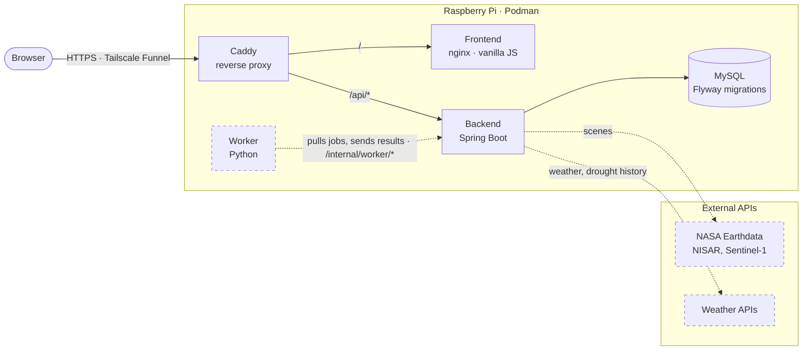

# River Lifeline

NISAR SAR change detection: a map and dashboard of monitored sites with their radar backscatter (VV/VH) time series.

**Demo:** https://raspberrypi.tail0a4b52.ts.net/river-lifeline/

| Layer | Technology |
|---|---|
| Backend | Java 21, Spring Boot, MySQL 8, Flyway |
| Frontend | Vanilla JavaScript (ES modules), Leaflet |
| Worker | Python 3.12: SAR image processing and drought forecasting |
| Infrastructure | Podman + Caddy on a Raspberry Pi, published with Tailscale Funnel |
| CI/CD | GitHub Actions, images on GHCR |

## Architecture



Dashed: planned, not running yet. The browser only talks to the backend (through Caddy), the backend is the only part
that calls external APIs, and the worker only talks to the backend: it pulls jobs and their inputs, and posts results
back. Details: [worker/README.md](worker/README.md) and [AGENTS.md](AGENTS.md).

## Run it locally

```bash
npm --prefix frontend install               # once per clone: Prettier + the pre-commit hook
docker compose -f compose.dev.yml up -d    # MySQL + frontend on http://localhost:5500 (/api -> :8080)
cd server && mvn spring-boot:run            # backend on :8080, using that MySQL
```

Full stack, as in production: see `compose.build.yml`. CI/CD, deployment and rollback: [docs/devops.md](docs/devops.md).
